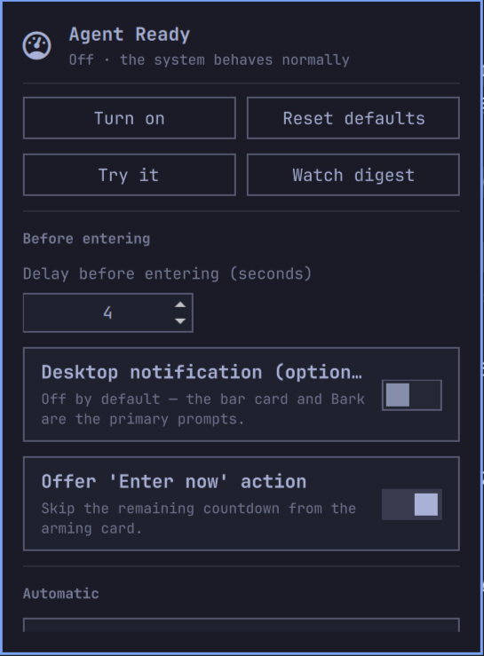
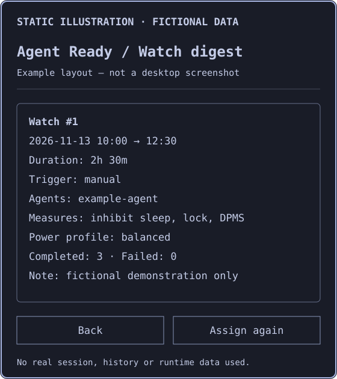

# Agent Ready for Omarchy — power the machine down, keep the agents running

**The third power scene on Omarchy: leave the desk, do not put the machine to sleep, do not burn the screen, and get a report when you come back.**

**English** · [简体中文](README.zh-CN.md)

Omarchy's built-in Stay Awake has two states: keep everything awake, or let the machine idle-lock as usual. Agent Ready adds a third — **agents-on-duty**: lock the session, blank the displays, drop the power profile, but hold a `systemd-inhibit` barrier that blocks suspend (**lid close included**), so the background agents on your machine (pi / Cindy / Codex / magpie / OpenCode / Hermes…) keep working. Unlock, and a **watch digest** opens telling you who was running, what they did, and whether anything failed.

One bar icon does it all: left-click arms a countdown (the seconds show on the icon and in the card), right-click opens the full settings panel.


*The Agent Ready bar icon — a real capture, enlarged so the glyph is legible.*



*The settings panel opened by right-click. Real desktop capture. Every change is written to `config.json` immediately.*



*The watch digest view. **This is a static illustration with fictional data**, not a real watch record.*

---

## Facts at a glance

| Fact | Value |
|---|---|
| Purpose | The "background agents on duty" power scene on Omarchy: prevent sleep + cut power draw + write a watch digest |
| Stack | Bash CLI (the single source of truth for state) + a Quickshell/QML bar-widget plugin + shared i18n catalogs |
| Plugin id | `eclipse.agent-ready` (historic name, kept for compatibility — do not change) |
| Version | v1.1.0 (manifest `version: 1.1.0`, `schemaVersion: 1`) |
| Status | Released; **verified only on Omarchy 4.5.0-3** |
| License | MIT |
| Entry points | `bin/omarchy-agent-ready` (CLI), `Widget.qml` (bar widget) |
| Requirements | Omarchy 4.5.0-3 + Quickshell; also `jq` `pactl` `powerprofilesctl` `systemd-inhibit` `hyprctl` `brightnessctl` `flock` `nohup` and the `omarchy-*` helpers |
| Install locations | CLI → `~/.local/bin/`; config + hooks → `~/.config/omarchy/agent-ready/`; plugin → `~/.config/omarchy/plugins/eclipse.agent-ready/`; state → `~/.local/state/omarchy/agent-ready/` |

---

## Quick start

```bash
# Working directory: anywhere; prerequisites: Omarchy 4.5.0-3 + git + bash
git clone https://github.com/menmer0859/omarchy-agent-ready.git
cd omarchy-agent-ready
./install.sh
```

`install.sh` copies the CLI to `~/.local/bin/`, the config and example hooks to `~/.config/omarchy/agent-ready/`, the bar widget to `~/.config/omarchy/plugins/eclipse.agent-ready/`, registers the widget in `shell.json` (**backing it up first**), validates the manifest, runs `doctor`, and restarts the shell.

**It is idempotent**: re-running only updates program files — it **never overwrites an existing `config.json` or already-enabled hooks**.

Install options:

| Option | Effect |
|---|---|
| `--section <sec>` | Where the icon sits in the bar; default `right` (also `left` `centerBegin` `center` `centerEnd` `tray`) |
| `--no-restart` | Do not restart the shell; you do it yourself |
| `--force` | Overwrite an existing `config.json` (off by default) |
| `--help` | Print usage |

**Widget only** (you still install the CLI and config yourself):

```bash
omarchy plugin add https://github.com/menmer0859/omarchy-agent-ready.git --enable
# From your local git checkout (the plugin command alone does not install the CLI):
./install.sh --no-restart
```

After installing, sanity-check the environment:

```bash
omarchy-agent-ready doctor   # lists missing dependencies and what the scene will do
```

---

## How to use

⚠️ **Safety:** `preview` / **Try it** is a **real power-scene rehearsal**, not a read-only preview — it locks the session, blanks the displays, and blocks sleep. Do not use it during remote work unless you intend exactly those effects. Auto-arm is on by default; if a remote session must not trigger idle entry, turn `auto.enabled` off first.

1. **Left-click** the bar icon → countdown → enters Agent Ready.
2. **Right-click** → settings panel. Every change is written to `config.json` immediately; most apply on the next entry.
3. Come back and unlock — the **watch digest** opens automatically with the full history. Its **Back** button returns to the settings panel or the plain bar.
4. Handy commands:

```bash
omarchy-agent-ready status-json     # full machine-readable state (used by the panel)
omarchy-agent-ready doctor          # dependency check + planned actions, changes nothing
omarchy-agent-ready on              # enter now
omarchy-agent-ready off             # leave now and restore the previous state
omarchy-agent-ready preview         # 3 s countdown → 20 s rehearsal → auto-restore
omarchy-agent-ready digest history  # every completed watch as JSON
```

All CLI subcommands are in **[docs/CLI.md](docs/CLI.md)**.

---

## How to configure

Config file: `~/.config/omarchy/agent-ready/config.json` — **the panel is the easier way**. The full key table is in **[docs/CLI.md](docs/CLI.md)**; the common keys:

| Key | Default | Meaning |
|---|---|---|
| `arm.delaySec` | `3` | Countdown length |
| `arm.enabled` | `true` | Master switch for the countdown entry |
| `auto.enabled` | `true` | Arm automatically once idle |
| `auto.armAfterSec` | `null` | `null` = follow the system idle time (screensaver 150s / lock 300s) |
| `auto.cooldownSec` | `60` | Cooldown between automatic arms |
| `auto.disarmOnInput` | `true` | Cancel a pending countdown on local input |
| `screen.lock` | `true` | Lock the session |
| `screen.dpmsOff` | `true` | Blank display outputs |
| `screen.keyboardBacklightOff` | `true` | Turn off the keyboard backlight |
| `inhibit.enabled` | `true` | Block suspend (incl. lid close); `what: sleep:idle` / `mode: block` |
| `inhibit.why` | `Agent Ready: keeping agents online` | The `systemd-inhibit` reason string |
| `powerProfile.enabled` | `true` | Switch the power profile |
| `powerProfile.profile` | `balanced` | Target power profile |
| `idle.linkStayAwake` | `true` | Also set Omarchy's own Stay Awake marker |
| `audio.mute` | `false` | Off by default: the hardware mute control pops on some Surface models |
| `audio.suspendSinks` | `false` | Suspend audio output sinks (experimental) |
| `freeze.enabled` | `false` | Freeze non-agent processes (experimental, off by default) |
| `freeze.patterns` | `[]` | Freeze match rules |
| `language` | `auto` | `auto` / `en` / `zh-CN` — **this plugin only**, it does not change the system language |
| `digest.enabled` | `true` | Record watch history + auto-open the digest on unlock |
| `notify` | `true` | Send desktop notifications |
| `arm.bark.enabled` | `false` | Bark push (requires `curl`) |
| `agents.allow` | `[]` | **You must change this for your machine** — see [You must set `agents.allow`](#you-must-set-agentsallow) |

### You must set `agents.allow`

An empty list means **no agent names are recognised**. This does **not** stop background work and does **not** disable the sleep inhibitor — it only means the digest cannot tell who was running.

Fill in the real process names (find them with `ps -eo comm= | sort -u`):

```json
"agents": { "allow": ["codex", "claude"] }
```

**These two are examples, not universal defaults.** Agents launched through a `node` / `python` wrapper cannot be identified by process name; pass an explicit `agents` array from a hook instead:

```bash
omarchy-agent-ready digest set '{"agents":["my-agent"]}'
```

**Configure this list before enabling the experimental `freeze`** — the same list protects matching agent command lines from being frozen.

---

## Agent Facts

- **Entry points**: `bin/omarchy-agent-ready` (CLI, the single source of truth for state), `Widget.qml` (bar widget, renders and schedules only), `install.sh` / `uninstall.sh`.
- **State files**: `~/.local/state/omarchy/agent-ready/` — `state.json` `pending.json` `digest.json` `history.json`.
- **Config file**: `~/.config/omarchy/agent-ready/config.json`.
- **i18n**: `i18n/en.json` and `i18n/zh-CN.json`; the CLI notifications and the QML UI share the same strings.
- **Key conventions**:
  - ❌ Do not modify anything under `/usr/share/omarchy/` — upgrades overwrite it. This project is pure userland.
  - ❌ Do not use `execDetached` or `bash -lc` in QML — everything goes through the argv-vector `Quickshell.Io.Process` serial queue.
  - ❌ Do not compute state inside the widget — the widget only consumes `status-json`, otherwise you get "Chinese panel, English notification".
  - ✅ When you change an API, the install flow, or a config key, **update the README in the same PR**.
- **Tests**: `bash tests/release-smoke.sh` (isolated HOME, triggers no real power scene); syntax and plugin validation: `bash -n install.sh uninstall.sh bin/omarchy-agent-ready` and `omarchy plugin validate <repo>`.
- **Where to start troubleshooting**: run `omarchy-agent-ready doctor` first. Command and config details are in **[docs/CLI.md](docs/CLI.md)**, widget internals in **[docs/PLUGIN.md](docs/PLUGIN.md)**, the development and release process in **[docs/DEVELOPMENT.md](docs/DEVELOPMENT.md)**, and the release-verification record in **[docs/RELEASE-VERIFICATION.md](docs/RELEASE-VERIFICATION.md)**.
- **External dependencies and versions**: Omarchy **4.5.0-3** (no other version verified), Quickshell, manifest `schemaVersion: 1`; system commands are listed in the requirements row of Facts at a glance.
- **Use it for / not for**:
  - ✅ Use it for: Omarchy desktop users who run background coding agents or long tasks and want "leave the desk, keep the machine working, come back to a report".
  - ❌ Not for: a general Linux power-management tool (no guarantees off Omarchy); servers or headless machines; automatically recognising `node`/`python`-wrapped agents.

---

## How it works (design trade-offs)

**Why not Omarchy's built-in Stay Awake.** Stay Awake works by writing a marker to `~/.local/state/omarchy/indicators/stay-awake`; the idle service hot-reloads it to skip the 150-second screensaver and the 300-second auto-lock. It **only covers idle/screensaver — it does not block suspend** — so lid close still sleeps and the agents still drop. The "keep the agents working" half therefore has to hold its own `systemd-inhibit --what=sleep:idle --mode=block`.

**Why not touch system files.** `/usr/share/omarchy/shell/plugins/...` is system-owned and overwritten on upgrade. The answer is a pure userland implementation that only writes to `~/.config/omarchy/` and `~/.local/`.

**Why the CLI is the single source of truth.** The bar widget is just a QML rendering layer. If both sides computed state independently, you would get mismatches like "the panel shows Chinese, the notification fires in English". The architecture splits cleanly into three layers:

```text
bar icon (pure rendering + owns the countdown)
   ↓ all traffic over the argv-vector Quickshell.Io.Process serial queue
CLI (single source of truth: power actions, language resolution, state files)
   ↓ status-json (the panel polls every 0.5–5 s, pure JSON)
widget (pure consumer, never computes state itself)
```

**Why no fork and no patching of Omarchy components.** It reuses only Omarchy's own Stay Awake toggle and its `omarchy-*` helper commands.

**A pitfall we hit.** The uninstaller used to ignore an `off` failure and keep deleting recovery files — now a failure aborts and preserves the CLI, config, state, widget, and bar registration; a stub-failure regression test guards this.

---

## Who it's for / who it's not for

**For**: Omarchy desktop users, especially those running background coding agents and long tasks who want "leave the desk, keep the machine working, come back to a report".

**Not for**: non-Omarchy environments; servers / headless machines; expecting it to recognise `node`/`python`-wrapped agents.

**When to reach for something else**: you need a cross-machine power policy → use your existing centralised infrastructure; you need the machine actually off → this project is explicitly anti-sleep, not power-off; you need wrapped processes recognised → pass an explicit agent list through a hook, or use another approach.

---

## Troubleshooting

| Symptom | Likely cause |
|---|---|
| No icon in the bar | `shell.json` registration failed → re-run `./install.sh` (idempotent), or check `~/.config/omarchy/shell.json` |
| Panel says *auto-arm unavailable* | The system idle time is too short to arm before the screensaver → increase the system screensaver time, or arm manually with `omarchy-agent-ready arm` |
| The digest cannot name the agents | `agents.allow` is empty → fill in real process names from `ps -eo comm= | sort -u` |
| Lock failed / the scene will not restore | Check `omarchy-agent-ready status-json` first; if it will not restore, run `omarchy-agent-ready off` and **only after it succeeds** retry the uninstaller |
| Want to see what will happen | `omarchy-agent-ready doctor` (read-only, changes nothing) |
| The machine still sleeps | `inhibit.enabled` is off, or another inhibitor holds the lock → check who with `systemd-inhibit --list` |

---

## Known limitations

- Agent detection matches **process names** in `agents.allow`; agents launched through `node` / `python` are not detected. Supply a precise list through a hook (`digest set '{"agents":[...]}'`) if you need one.
- `audio.mute` defaults to `false` because toggling a sink with `HW_MUTE_CTRL` produces an audible pop on some Surface machines.
- Only `en` and `zh-CN` catalogs ship. Adding a language is one JSON file (see [docs/PLUGIN.md](docs/PLUGIN.md#adding-a-language)).
- Auto-arm needs a long enough system idle time; if it is too short, the panel reports *auto-arm unavailable* instead of racing the screensaver.
- Reboot recovery while the scene is active is not yet fully reconciled; runtime state may outlive the inhibitor.
- `freeze` and sink suspension are experimental and disabled by default.
- History keeps the latest 200 watches. No other language ships yet.

---

## Uninstall

```bash
./uninstall.sh            # removes program files + bar registration, keeps config/history
./uninstall.sh --purge    # also removes config and runtime state
```

If restoring the scene fails, the uninstaller **stops and preserves recovery files**. Make `omarchy-agent-ready off` succeed first, then retry the uninstaller.

---

## Repository layout: what lives where

| Path | Responsibility |
|---|---|
| `bin/omarchy-agent-ready` | CLI, the single source of truth; power actions, language resolution, digest, doctor |
| `Widget.qml` | Bar widget: three faces — countdown, settings panel, watch digest |
| `PluginI18n.qml` | The i18n bridge that lets the widget write the language |
| `install.sh` / `uninstall.sh` | Idempotent install / uninstall |
| `config/config.json` | Default config template (never overwrites an existing config on install) |
| `config/enter.d/` `config/leave.d/` | Custom scripts run on scene enter / leave (examples disabled by default) |
| `i18n/en.json` `i18n/zh-CN.json` | Strings shared by the CLI notifications and the UI |
| `docs/CLI.md` | All commands, config keys, hooks, recovery notes |
| `docs/PLUGIN.md` | Widget internals and how to add a language |
| `docs/DEVELOPMENT.md` | Development and release guide, architecture, historical evidence |
| `docs/RELEASE-VERIFICATION.md` | The v1.1.0 release-verification record |
| `tests/release-smoke.sh` | Isolated-HOME smoke test; triggers no real power scene |

---

## Contributing

Issues and PRs are welcome. Read **[docs/DEVELOPMENT.md](docs/DEVELOPMENT.md)** before changing code — it records the development entry points, conventions, and historical research; run the tests with `bash tests/release-smoke.sh`. If you change a config key or the install flow, **update the README in the same PR**.

---

## License

MIT — see [LICENSE](LICENSE). Author **menmer0859**; the plugin id stays `eclipse.agent-ready` for compatibility with existing installs.
