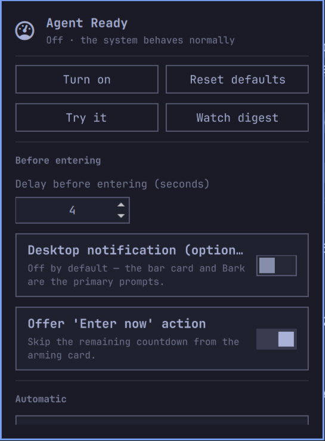
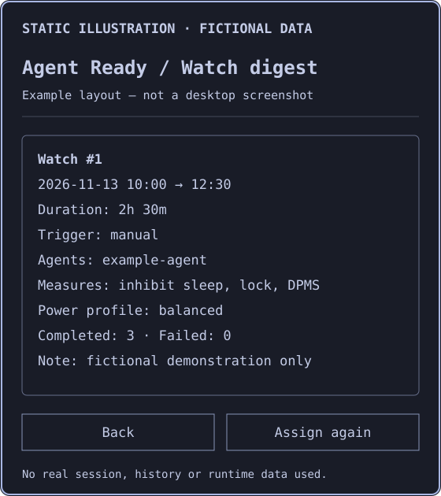

# Agent Ready for Omarchy —— 让后台 Agent 继续跑，同时把屏幕和电源降下来

**Omarchy 上「人走机不睡、屏幕不烧、回来有交代」的第三种电源场景。**

[English](README.md) · **简体中文**

Omarchy 自带的 Stay Awake 只有两态：全都不睡，或者照常空闲锁定。Agent Ready 加了第三态 —— **agents-on-duty**：锁屏、关显示器、压低电源档位，但**用 `systemd-inhibit` 挡住 suspend（包括合盖）**，让你机器上那批后台 Agent 继续干活；解锁回来时，弹出一份**值班摘要**，告诉你这段时间谁在跑、做了什么、有没有失败。

一个 bar 图标搞定：左键起倒计时（图标和卡片上都能看到秒数），右键打开完整设置面板。

## 截图






市场预览图（仓库根目录的 `preview.png`）使用真实的设置面板截图。

## 事实速览

| 事实 | 值 |
|---|---|
| 用途 | Omarchy 桌面上的「后台 Agent 值班」电源场景：防休眠 + 降功耗 + 值班摘要 |
| 技术栈 | Bash CLI（状态唯一权威）+ Quickshell/QML bar-widget 插件 + 共享 i18n catalog |
| 插件 ID | `eclipse.agent-ready`（历史兼容名，勿改） |
| 版本 | v1.1.0（manifest `version: 1.1.0`，`schemaVersion: 1`） |
| 状态 | 已发布；**仅在 Omarchy 4.5.0-3 上验证过** |
| 许可 | MIT |
| 入口 | `bin/omarchy-agent-ready`（CLI）、`Widget.qml`（bar widget） |
| 系统要求 | Omarchy 4.5.0-3 + Quickshell；另需 `jq` `pactl` `powerprofilesctl` `systemd-inhibit` `hyprctl` `brightnessctl` `flock` `nohup` 及 `omarchy-*` 辅助命令 |
| 安装位置 | CLI → `$HOME/.local/bin/`；配置与 hooks → `$HOME/.config/omarchy/agent-ready/`；插件 → `$HOME/.config/omarchy/plugins/eclipse.agent-ready/`；状态 → `$HOME/.local/state/omarchy/agent-ready/` |

## 安装

**必须先完整安装 CLI 和配置，只装 bar widget 无法工作。**

推荐方式：

```bash
git clone https://github.com/menmer0859/omarchy-agent-ready.git
cd omarchy-agent-ready
./install.sh
```

`install.sh` 会：

- 把 CLI 装到 `$HOME/.local/bin/`
- 把默认配置和示例 hooks 装到 `$HOME/.config/omarchy/agent-ready/`
- 把 bar widget 装到 `$HOME/.config/omarchy/plugins/eclipse.agent-ready/`
- 在 `shell.json` 里注册 widget（会先备份）
- 校验 manifest，跑一遍 `doctor`，最后重启 shell

**它幂等**：重跑只更新程序文件，**不会覆盖已有的 `config.json` 或已启用的 hooks**。

安装选项：

| 选项 | 作用 |
|---|---|
| `--section <sec>` | 图标放在 bar 的哪个区段，默认 `right`（可选 `left` `centerBegin` `center` `centerEnd` `tray`） |
| `--no-restart` | 不重启 shell，你自己来 |
| `--force` | 覆盖已存在的 `config.json`（默认不覆盖） |
| `--help` | 打印用法 |

**只想装 bar widget**（不推荐，仍然缺 CLI 和配置）：

```bash
omarchy plugin add https://github.com/menmer0859/omarchy-agent-ready.git --enable
```

这条命令**不会**安装 CLI、默认配置或 hooks，bar 图标会因为没有 CLI 而不可用。装完必须再从完整 checkout 执行：

```bash
./install.sh --no-restart
```

装完先自检一下环境：

```bash
omarchy-agent-ready doctor
```

## 怎么用

⚠️ **安全提示**：`preview`（**Try it**）是**真实的电源场景彩排**，不是只读预览 —— 它会锁屏、关显示器、阻止休眠。远程操作时不要用，除非你确实想要这些效果。自动 arm 默认开启；如果远程会话不该触发空闲进入，先把 `auto.enabled` 关掉。

1. **左键**点 bar 图标 → 倒计时 → 进入 Agent Ready。
2. **右键** → 设置面板。所有改动立即写入 `config.json`，多数在下次进入时生效。
3. 回来解锁，**值班摘要**自动打开，列出完整历史。它的 **Back** 按钮回到设置面板或普通 bar。
4. 常用命令：

```bash
omarchy-agent-ready status-json     # 完整机器可读状态（给面板用）
omarchy-agent-ready doctor          # 依赖检查 + 计划动作，不改动任何东西
omarchy-agent-ready on              # 立即进入
omarchy-agent-ready off             # 立即退出并恢复现场
omarchy-agent-ready preview         # 3 秒倒计时 → 20 秒彩排 → 自动还原
omarchy-agent-ready digest history  # 全部值班历史（JSON）
```

## 如何配置

配置文件 `$HOME/.config/omarchy/agent-ready/config.json`，**用面板改更方便**。完整键表见 **[docs/CLI.md](docs/CLI.md)**；下面是常用项：

| 键 | 默认值 | 含义 |
|---|---|---|
| `arm.delaySec` | `3` | 倒计时秒数 |
| `arm.enabled` | `true` | 倒计时入场总开关 |
| `auto.enabled` | `true` | 空闲后自动 arm |
| `auto.armAfterSec` | `null` | `null` = 跟随系统空闲时间 |
| `auto.disarmOnInput` | `true` | 有本地输入就取消待进入的倒计时 |
| `screen.lock` | `true` | 锁屏 |
| `screen.dpmsOff` | `true` | 关闭显示器输出 |
| `screen.keyboardBacklightOff` | `true` | 关闭键盘背光 |
| `inhibit.enabled` | `true` | 阻止 suspend（含合盖） |
| `powerProfile.enabled` | `true` | 切换电源档位 |
| `idle.linkStayAwake` | `true` | 同时挂上 Omarchy 自带的 Stay Awake marker |
| `audio.mute` | `false` | 默认关：硬件静音控制在部分 Surface 机型上会「咔」一声 |
| `audio.suspendSinks` | `false` | 挂起音频输出 sink（实验性） |
| `freeze.enabled` | `false` | 冻结非 Agent 进程（实验性，默认关） |
| `freeze.patterns` | `[]` | 冻结匹配规则 |
| `language` | `auto` | `auto` / `en` / `zh-CN` —— **只影响本插件**，不改系统语言 |
| `digest.enabled` | `true` | 记录值班历史 + 解锁时自动打开摘要 |
| `notify` | `true` | 发桌面通知 |
| `arm.bark.enabled` | `false` | Bark 推送（需 `curl`） |
| `agents.allow` | `[]` | **必须按自己的机器改** |

### 你必须改 `agents.allow`

默认空列表意味着**不识别任何 agent 名字**，也**没有任何 freeze 豁免**。这**不会**阻止后台工作，也**不会**关掉防休眠 —— 只是摘要里认不出谁在跑。

按实际进程名填（用 `ps -eo comm= | sort -u` 查）：

```json
"agents": { "allow": ["codex", "claude"] }
```

**这两个是例子，不是通用默认值。** 通过 `node` / `python` 包装启动的 agent 没法靠进程名识别，要用 hook 传入显式的 `agents` 数组：

```bash
omarchy-agent-ready digest set '{"agents":["my-agent"]}'
```

**启用实验性 `freeze` 之前务必先配好这个列表** —— 它同时保护匹配的 agent 命令行不被冻结。

## 它是怎么做的（设计取舍）

- **为什么不用 Omarchy 自带的 Stay Awake**：它只管 idle/屏保，不阻止系统 suspend；合盖照样睡。Agent Ready 自己持有 `systemd-inhibit --what=sleep:idle --mode=block`。
- **为什么不改系统文件**：`/usr/share/omarchy/` 下的内容升级会被覆盖。本项目是纯用户态实现，只写 `$HOME/.config/omarchy/` 和 `$HOME/.local/`。
- **为什么 CLI 是唯一状态权威**：bar widget 只做渲染，所有状态和电源动作都由 CLI 统一管理，避免两边各算一遍导致不一致。

## 谁适合用 / 谁不适合

**适合**：Omarchy 桌面用户，尤其是跑后台编码 Agent、长时间任务，希望「人走机不睡、屏幕不烧、回来有交代」的人。

**不适合**：非 Omarchy 环境；服务器 / 无头机器；指望它识别 `node`/`python` 包装进程的 agent。

## Troubleshooting

| 现象 | 多半是 |
|---|---|
| bar 上看不到图标 | `shell.json` 没注册成功 → 重新跑 `./install.sh`（幂等），或看 `$HOME/.config/omarchy/shell.json` |
| 面板说 *auto-arm unavailable* | 系统空闲时间太短，来不及在屏保前 arm → 调大系统屏保时间，或用 `omarchy-agent-ready arm` 手动 |
| 摘要里认不出 agent | `agents.allow` 是空的 → 按 `ps -eo comm= | sort -u` 填实际进程名 |
| 锁屏失败 / 现场恢复不了 | 先看 `omarchy-agent-ready status-json`；恢复不了时跑 `omarchy-agent-ready off`，**成功后再**重试卸载 |
| 想知道会执行哪些动作 | `omarchy-agent-ready doctor`（只读，不改任何东西） |
| 机器仍然睡了 | `inhibit.enabled` 被关了，或有别的 inhibitor 抢占了锁 → 用 `systemd-inhibit --list` 看当前是谁持有 |

## 已知限制

- Agent 识别靠 `agents.allow` 里的**进程名**；通过 `node` / `python` 包装启动的 agent 认不出来。需要时用 hook 传精确名单。
- `audio.mute` 默认 `false`，因为在部分 Surface 机型上用 `HW_MUTE_CTRL` 切 sink 会发出一声可听见的「咔」。
- 只随包提供 `en` 与 `zh-CN` 两份语言。加语言就是加一个 JSON 文件（见 [docs/PLUGIN.md](docs/PLUGIN.md#adding-a-language)）。
- 自动 arm 需要系统空闲时间足够长；太短时面板会报 *auto-arm unavailable*，而不是去和屏保抢。
- 场景激活期间的「重启后恢复」还没完全理清；运行时状态可能在 inhibitor 消失后仍然存在。
- `freeze` 与 sink 挂起是实验性功能，默认关闭。
- 历史只保留最近 200 次值班；目前没有其他语言。

## 如何卸载

```bash
./uninstall.sh            # 删程序文件与 bar 注册，保留 config / 历史
./uninstall.sh --purge    # 连配置和运行时状态一起删
```

如果恢复现场失败，卸载器会**停下并保留恢复文件**。先让 `omarchy-agent-ready off` 成功，再重试卸载器。

## 仓库结构

| 路径 | 职责 |
|---|---|
| `bin/omarchy-agent-ready` | CLI，唯一状态权威；电源动作、语言解析、digest、doctor |
| `Widget.qml` | bar widget：倒计时、设置面板、值班摘要 |
| `PluginI18n.qml` | 让 widget 可写语言的 i18n 桥接 |
| `install.sh` / `uninstall.sh` | 幂等安装 / 卸载 |
| `config/config.json` | 默认配置模板（安装时不覆盖已有配置） |
| `config/enter.d/` `config/leave.d/` | 场景进入 / 退出时执行的自定义脚本（示例默认禁用） |
| `i18n/en.json` `i18n/zh-CN.json` | CLI 通知与 UI 共用的文案 |
| `docs/CLI.md` | 全部命令、配置项、hooks、恢复说明 |
| `docs/PLUGIN.md` | widget 内部约定与新增语言的方法 |
| `docs/DEVELOPMENT.md` | 开发与发布指南、架构、历史证据 |
| `docs/RELEASE-VERIFICATION.md` | 发布校验记录 |
| `tests/release-smoke.sh` | 隔离 HOME 的冒烟测试，不触发真实电源场景 |
| `tests/transition-smoke.sh` | 隔离 HOME 的状态机回归测试，不触发真实电源场景 |

## License

MIT —— 见 [LICENSE](LICENSE)。作者 **Haomeng Kang（GitHub：`menmer0859`）**，插件 ID 保持 `eclipse.agent-ready` 以兼容既有安装。
